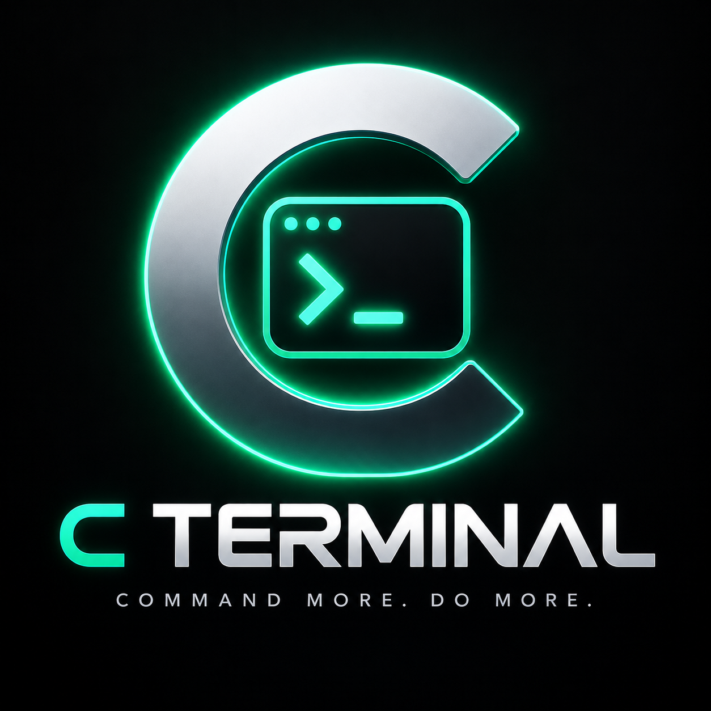

<p align="center"></p>

<h3 align="center">Your computer's terminal, in your pocket. Command more. Do more.</h3>

<p align="center">
  <a href="LICENSE"></a>
  
  
  
</p>

<p align="center"><a href="https://cterminal.thewiderlens.info">cterminal.thewiderlens.info</a> ·
<a href="https://github.com/TheWiderLensInitiative/c-terminal/releases/latest">Download</a> ·
<a href="docs/PRIVACY.md">Privacy</a> · <a href="SECURITY.md">Security</a></p>

C Terminal is a free, open-source Android app plus a small companion for your PC. Run any command or program on your
computer from your phone (a shell, `htop`, **Claude Code**, **Codex**) over your own private Tailscale network. No
cloud relay, no accounts, no SSH keys.

Most phone terminals make you watch the screen. **C Terminal tells you when it needs you:**

- **✅ / ❌ Finished:** a long command is done (or failed). The notification shows the last lines of output.
- **⌨️ Waiting for you:** a program is asking `[y/N]`, a password or "press Enter". Answer straight from the
  notification's Reply box.
- **🔐 Claude Code and Codex approvals:** in *away mode*, they ask your phone before they run anything. Tap **Allow**,
  **Deny** or **Always allow** on the lock screen (allowing needs the phone unlocked).
- **✨ Agent done:** Claude Code or Codex finished its turn, with its last message. Reply to give it the next task.

And the terminal itself:

- **Sessions that never die.** They live on the PC. Close the app, lose signal, switch phones: everything is still
  there, scrollback included. Continue the same session at your desk with `cterm attach`.
- **Your Tailscale account is the key.** The companion listens only on your Tailscale addresses and lets in only
  devices signed in to the same Tailscale account (others can be added by login). Nothing to pair, nothing to leak.
- **Built for thumbs.** Swipe to scroll back (with a fling; full-screen apps get scroll-wheel input), Paste and Copy
  keys (long-press the terminal to select text), an extra-keys row (Esc, Tab, sticky Ctrl/Alt, arrows, ^C…), a line
  box with autocorrect and voice typing for talking to agents, full-color terminal (xterm.js), adjustable font.

## Install

**1. On the PC** (Linux; Tailscale installed and signed in):

```bash
curl -fsSL https://raw.githubusercontent.com/TheWiderLensInitiative/c-terminal/main/install.sh | bash
```

It installs the companion (no sudo), starts it at login, and offers to connect Claude Code. Run it again to update;
`./install.sh --uninstall` removes it.

**2. On the phone:** install the APK from [Releases](https://github.com/TheWiderLensInitiative/c-terminal/releases/latest),
make sure Tailscale is on (same account), tap **Add computer** and type the name the installer printed (like `clara-pc`).
Release APKs are signed with this certificate (SHA-256):
`D0:97:5D:08:D8:26:0A:86:C8:8F:E2:68:0B:A5:CA:53:D8:15:00:AA:AA:EE:8C:34:B9:CB:57:7F:81:98:2D:8B`

## Using it

| | |
|---|---|
| Start something | Open a computer → **Shell**, **Claude Code**, **Codex** or **Command…** |
| Away mode | Switch on the home screen. While it's on, Claude Code's permission prompts go to the phone instead of the PC screen. If nobody answers within 5 minutes, Claude asks on the PC as usual |
| At the desk | `cterm ls`, `cterm attach <id>` (Ctrl-] leaves it running), `cterm new --run claude` |
| Claude Code & Codex | `cterm hooks install` connects both (the installer offers it): permission prompts go to the phone in away mode, and you hear when they finish. Codex has no "Always allow" from a hook, so its approvals are Allow or Deny |

Settings live in `~/.config/c-terminal/config.json`: `port` (7420), `allowed_logins` (extra Tailscale logins to let in),
`notify_after_seconds` (10), `approval_timeout_seconds` (300), `scrollback_bytes`.

## How it works

```
 phone (C Terminal app) ──── Tailscale (WireGuard) ────▶ PC: cterm serve
   terminal  ◀── WebSocket: bytes both ways ──▶ shell on a pseudo-terminal (bash + C Terminal integration)
   inbox     ◀── WebSocket: events ──────────── finished / waiting / approval / agent_done
                                                 ▲
                Claude Code / Codex hooks ──────┘ (cterm hook claude|codex, local only)
```

- **Server** (`server/`, Python + aiohttp): sessions on pseudo-terminals with scrollback, a bash integration that marks
  where each command starts and ends (so "finished" is exact), a prompt detector for `[y/N]`/passwords, and the
  Claude Code `PermissionRequest` / `Notification` / `Stop` hooks.
- **App** (`android/`, Kotlin + Compose): xterm.js in a WebView for drawing; the connection itself lives in Kotlin
  (OkHttp), and a foreground service keeps one small event connection per computer for notifications.
- **Security:** see [SECURITY.md](SECURITY.md).

## Build it yourself

```bash
cd server && uv venv .venv && uv pip install --python .venv/bin/python -r requirements-dev.txt && .venv/bin/python -m pytest
cd android && ./gradlew assembleDebug        # JDK 17+ and the Android SDK
```

## Roadmap

Tailscale built into the app (no VPN slot needed) · biometric confirm for risky commands · quick-settings tile and
home-screen runbook buttons · zsh/fish integration · macOS companion · "explain this error" with a local model ·
send files and clipboard both ways.

---

Questions: cterminal@thewiderlens.info · Created by DevIgnite × The Wider Lens Initiative Project · Apache-2.0
